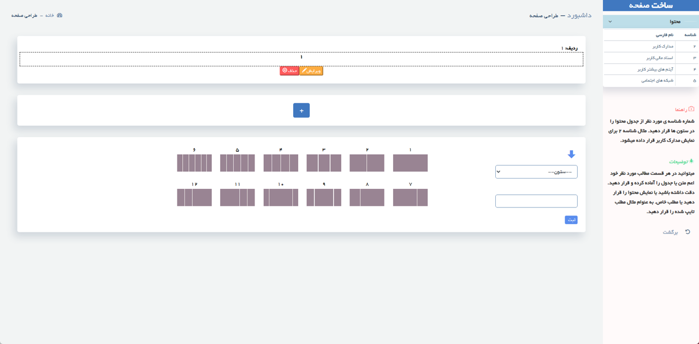
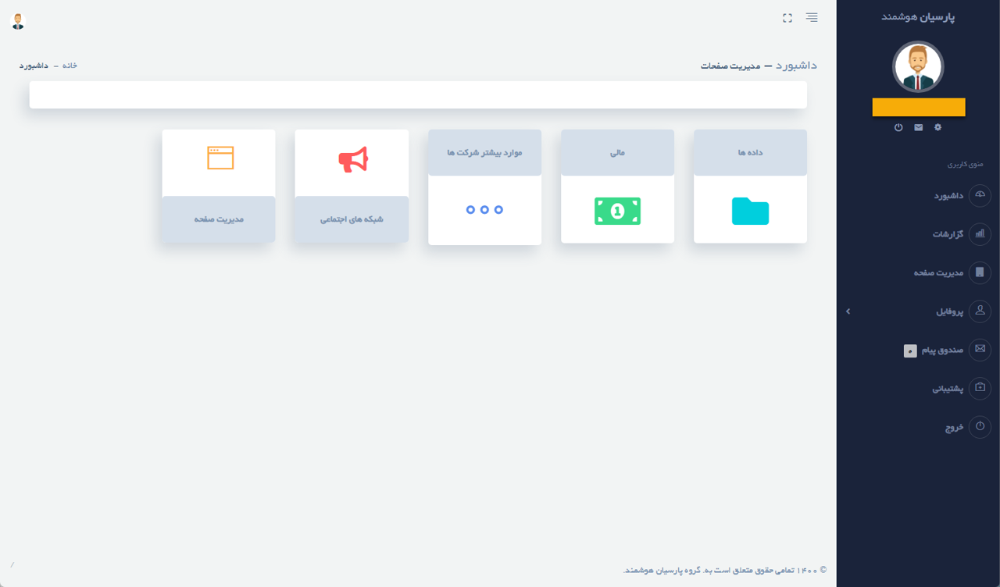

# Company Self-Reporting & Analytics

**Portfolio case study · C# / ASP.NET Core 8 · SQL Server**

A business application for collecting company self-reported information, managing company and financial records, and generating configurable reports. Developed by **Melika Mehranpour**, with an existing ASP.NET MVC 5 application migrated to ASP.NET Core 8.

## Business purpose

A Persian, right-to-left portal for company self-reporting and controlled publication. Administrators and customers maintain company profiles, documents, financial records, and public pages. Companies can choose whether to appear publicly; individual documents and financial records have separate publication controls.

The application combines configurable master data, a report builder, member administration, a custom Page Builder, site content management, and ticket-based support.

## Featured work: custom Page Builder

Designed and implemented a custom row-and-column editor for customer pages. Each row has its own choice of **twelve predefined layouts**, including equal and unequal column widths. Administrators add, edit, and delete rows and assign content to individual columns.

Columns can contain formatted text or tables, or reference a member-specific content source: documents, financial records, additional fields, or social links. A Persian help sidebar explains the source identifiers. This connects reusable customer data with a configurable page presentation. The migration includes ASP.NET Core ViewComponent integration and session handling for the active page.

**[Explore the Page Builder case study and selected samples](docs/page-builder.md).**

## Screenshot walkthrough

[Browse all 48 screenshots with individual explanations](screenshots/README.md): public website, master data, reports, operator permissions, member registration, documents, finance, social links, publication, Page Builder, CMS, tickets, and customer self-service.

Previews use reduced display widths. The gallery preserves the developer's masking of identifying fields and additionally masks the customer login email. The calculations-menu screenshot documents planned, unimplemented modules.

## My work

- Designed and implemented the custom Page Builder for composing and maintaining customer pages.
- Developed company/customer workflows and administrator functionality.
- Migrated the legacy MVC application to ASP.NET Core MVC and EF Core.
- Adapted authentication, sessions, dependency injection, and Razor integration.
- Implemented dynamic report execution and corrected report-field persistence.
- Resolved migration issues involving JSON property names, nullable input models, and empty view models.

## Selected code samples

This repository presents **selected excerpts**, not the full application. Enclosing classes, database entities, configuration, remaining workflows, and supporting dependencies are intentionally omitted. These files are for code review and are not a standalone runnable project.

| Sample | What it demonstrates |
| --- | --- |
| [Page Builder row creation](samples/csharp/PageBuilderCreateRow.cs) | Page context, access checks, and row persistence |
| [Page Builder column mapping](samples/csharp/PageBuilderColumnContent.cs) | Content assignment for twelve predefined layout variants |
| [Page Builder sidebar](samples/csharp/PageBuilderSidebarComponent.cs) | ASP.NET Core ViewComponent with database-backed data sources |
| [Page Builder Razor integration](samples/razor/PageBuilderSidebar.cshtml) | Invoking the component from a layout |
| [Dynamic report query](samples/csharp/DynamicReportQuery.cs) | SQL Server data access, permitted data sources, identifier checks, and resource disposal |
| [Report execution action](samples/csharp/ReportExecutionAction.cs) | Access checks, saved report definitions, metadata validation, and result preparation |
| [Field-selection endpoint](samples/csharp/ReportFieldEndpoint.cs) | An explicit JSON contract between C# and the selection UI |
| [Report edit loading](samples/csharp/ReportEditLoading.cs) | Restoring saved selections and separating selected/available fields |
| [Customer activation gate](samples/csharp/CustomerActivationGate.cs) | Active-account and customer-role checks after credential lookup |
| [Customer page scope](samples/csharp/CustomerPageScope.cs) | Session lookup, legacy profile check, and a customer-scoped page list |
| [Document publication selection](samples/csharp/DocumentPublicationSelection.cs) | Operator permission check and customer-scoped published-document choices |
| [Published member data](samples/razor/PublishedMemberData.cshtml) | Customer and publication filters for documents, finances, and social links |
| [Page Builder document rendering](samples/razor/PageBuilderDocumentRendering.cshtml) | Rendering the document content branch in a one-column layout |
| [Audit logging](samples/csharp/AuditLogging.cs) | EF Core persistence of audit events |
| [Report table](samples/razor/ReportTable.cshtml) | A small Razor example rendering dynamic columns and rows |

The C# excerpts show selected backend responsibilities; the Razor excerpts illustrate their presentation.

See [sample context and limitations](docs/sample-context.md) for the new excerpts and their original source locations.

## Application capabilities

The following scope is documented from the developer's walkthrough and application screenshots. The selected code samples cover only part of these workflows.

| Area | Capabilities |
| --- | --- |
| Public website | Member directory, opt-in company visibility, published profiles and custom pages, about and contact sections |
| Operator administration | Operator accounts and profiles, role selection, active status, and separate access settings for master data, pages, reports, support, and customers |
| Member registration | Conditional forms for natural persons and legal entities; personal details or company details, representative/CEO information, contact details, image/logo, and account status |
| Company administration | List, view, edit, delete, change password, and open the selected member's documents and financial records |
| Documents | Per-member records with document name, type, value, registration date, file uploads and file links, editing, deletion, and an empty state |
| Financial records | Per-member amounts, configured expense categories, currency selection, and daily, weekly, monthly, quarterly, semiannual, or annual periods |
| Additional fields | Persian/English item names, values and descriptions; person-to-company selection; publication settings and separate associations with profile, documents, or financial information |
| Social links | Persian/English names, URLs, descriptions, publication status, and configurable Font Awesome icons with readable selection labels |
| Page management | Create, view, edit, delete, and publish/unpublish member pages; shortcuts to the same member's profile, documents, finances, and page design |
| Selective disclosure | Publish or withdraw individual documents and financial records; separate lists of published and unpublished items |
| Page Builder | Independent row layouts, column content, formatted text/tables, and references to member data |
| Dynamic reports | Saved report definitions, source and field selection, editing, deletion, and dynamic tabular results |
| Site CMS | Contact information, About Us, and terms/rules; rich-text editing, creation, editing, deletion, and publication/draft settings |
| Support tickets | Status totals, ticket list, conversation history, operator replies, status changes, and attachment links |
| Audit | Selected audit-event persistence, illustrated in the code excerpts |

### Customer onboarding and self-service

Customers use a separate member login and dashboard. A person or company must complete its profile and have an active account before using the operational features. Profile completion can be performed by the customer or by an administrator at the customer's request.

After activation, customers can create reports and manage their own documents, financial records, additional fields, social links, and pages. They can publish or withdraw their content and pages. The customer panel also provides profile editing, password changes, a message inbox, and support access.

### Configurable master data

Administrators maintain definitions through add, edit, and delete workflows. These include industry groups, document/data types and definitions, financial years and periods, financial item definitions, currencies and conversion settings, measurement units, mathematical operators, adjustment indices, social icons, and ticket statuses.

### Metadata-driven reporting

The report editor offers company document data, financial data, and company/person information as sources. Administrators move metadata-defined fields between available and selected lists, save a report, reopen its field selection, and run it without entering SQL in the interface. Results use dynamic columns with readable Persian captions.

### Publication and navigation

Public visibility is a deliberate choice. Publishing a member page does not automatically publish every document or financial record. Dedicated publish and withdraw screens manage those items separately. Shortcuts connect member administration, additional fields, social links, documents, finances, and page management.

## Technology

C#, ASP.NET Core MVC (.NET 8), Entity Framework Core 8, SQL Server, Microsoft.Data.SqlClient, Razor, jQuery, EPPlus, and Newtonsoft.Json.

## Project status and verification

The project was **stopped before the specialized calculation modules were implemented**. ELECTRE, TOPSIS, and normalization appear as planned menu entries; their calculations are not implemented and are not claimed as completed features.

**November 2, 2026:** migration and dynamic-reporting fixes reached a developer-verified milestone. Company document-data report execution and saved report-field editing were confirmed locally by the developer. Financial and company/person report execution still require explicit verification. No build or end-to-end test was run in the portfolio preparation environment.

See [migration notes](docs/migration-notes.md) for selected implementation decisions and remaining work.

## Source availability

The current repository tree intentionally contains documentation and selected samples only. Full source, database contents, uploads, static assets, connection details, and credentials are not part of this portfolio snapshot. No build or end-to-end run of these excerpts is claimed.

## Author

👩‍💻 Melika Mehranpour  
Senior Software Engineer | .NET & Enterprise Systems

C# • ASP.NET Core 8 MVC • EF Core 8 • SQL Server • Razor • jQuery

Project focus: a company self-reporting web portal with a custom Page Builder, configurable reports, and administrator/customer workflows; migrated from ASP.NET MVC 5 to ASP.NET Core 8.

🔗 [LinkedIn](https://www.linkedin.com/in/melika-mehranpour-41b627161/) | [GitHub](https://github.com/MelikaWorks)

## License

No license has been assigned to this repository. The selected code excerpts are shared for portfolio review; no permission to reuse the client application's code is implied.
